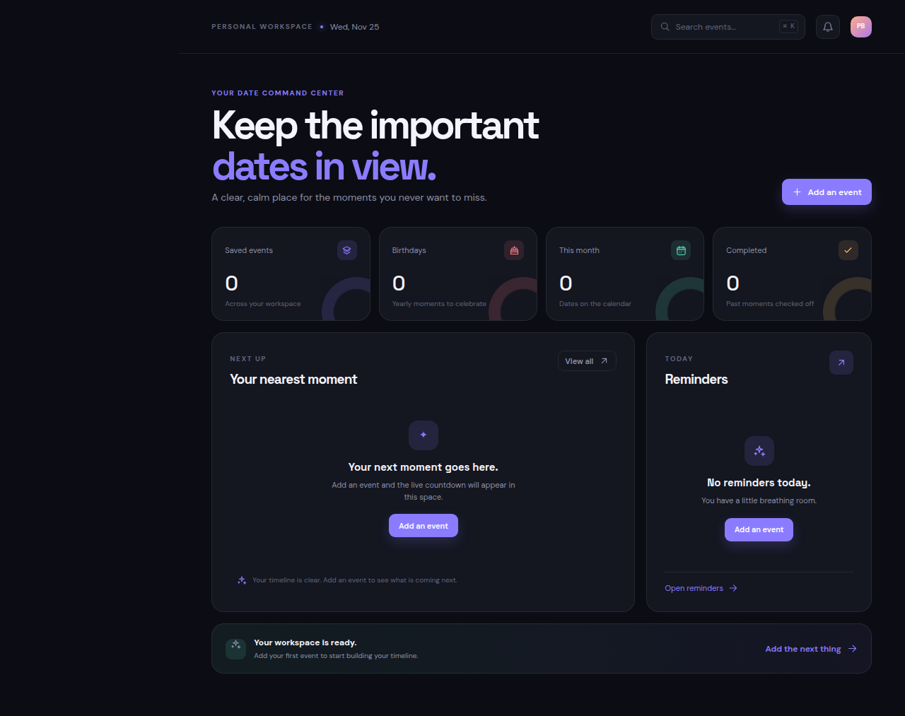
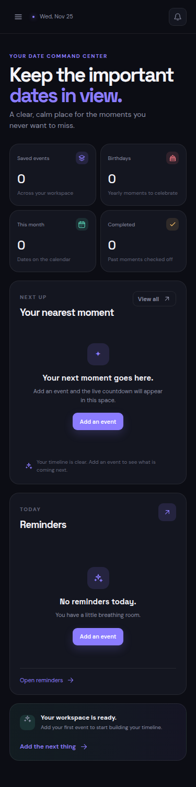

# Event & Reminder Manager

Event & Reminder Manager is a full-stack date command center for birthdays, anniversaries, festivals, meetings, exams, personal dates and reminders. It is built as a responsive single-page web application with a Node.js/Express REST backend and a persistent SQLite database.

## Highlights

The app includes a calm dashboard with totals and monthly activity, event creation/editing/deletion, search and category/date filters, annual birthday recurrence with age and remaining-day calculations, a month calendar with event markers, upcoming views for 7/30 days and birthdays, live countdowns, reminder lead times, duplicate-safe acknowledgement logs, in-app reminder cards, optional browser notifications, dark/light themes, date formats, and cleanup controls for old data.

## Technologies

- Node.js 22+
- Express 5
- SQLite via `better-sqlite3`
- Vanilla HTML5, CSS3 and JavaScript modules
- Platform-managed Preview runtime on port 3000

## Run locally

```bash
pnpm install
pnpm start
```

Then open `http://localhost:3000`. The application creates `data/events.db` automatically on first start. The runtime database is intentionally ignored by Git; the schema is created by `db.js` each time the server starts.

For development with automatic Node restarts:

```bash
pnpm dev
```

The project uses pnpm 10.12.4 through the `packageManager` field. `better-sqlite3` is explicitly allowed to run its native build through `pnpm-workspace.yaml`.

## Project structure

```text
public/
  index.html
  css/style.css
  js/app.js
  js/calendar.js
  js/countdown.js
  manus-routes.json
routes/
  events.js
  birthdays.js
  reminders.js
  settings.js
db.js
server.js
plan.md
TODO.md
```

## API reference

All API routes return JSON except successful DELETE operations, which return `204 No Content`.

| Method | Endpoint | Purpose |
| --- | --- | --- |
| GET | `/api/health` | Server health check |
| GET | `/api/events` | List events; supports `search`, `category`, `from`, and `to` |
| POST | `/api/events` | Create a validated event |
| PUT | `/api/events/:id` | Update an event |
| DELETE | `/api/events/:id` | Delete an event |
| GET | `/api/events/dashboard` | Dashboard metrics, nearest events and today’s reminders |
| GET | `/api/events/calendar?month=YYYY-MM` | Calendar events for a month, including recurring occurrences |
| GET | `/api/birthdays` | List birthdays with next annual occurrence, age and remaining days |
| POST | `/api/birthdays` | Create a birthday |
| PUT | `/api/birthdays/:id` | Update a birthday |
| DELETE | `/api/birthdays/:id` | Delete a birthday |
| GET | `/api/reminders?date=YYYY-MM-DD` | Resolve reminders for a date and due notification state |
| POST | `/api/reminders/acknowledge` | Record a duplicate-safe reminder acknowledgement |
| DELETE | `/api/reminders/old` | Clear completed/old events and aged reminder logs |
| GET | `/api/settings` | Read workspace settings |
| PUT | `/api/settings` | Update theme, date format and notification preferences |

## Validation and notifications

Event and birthday forms validate required values in the browser, while the REST endpoints validate dates, times, categories, reminder lead times and text lengths again on the server. SQLite writes use parameterized statements. Browser notifications are requested only when the user presses **Enable browser alerts** and are supplemental to the in-app reminder center. The app avoids duplicate reminder nudges by combining a persisted acknowledgement key with a client-side due-state check.

## Screenshots

The visual system is a midnight command center with ink navy surfaces, Event Violet actions, mint/amber/coral status accents, rounded cards and mobile-first breakpoints.





## Verification

Run the source checks with:

```bash
pnpm run check
```

The implementation was also smoke-tested against the live REST server for event create/update/delete, search and filter, calendar payloads, recurring events, birthday recurrence, reminders, settings persistence and cleanup. The dashboard was visually inspected at desktop and 375px mobile widths.

## GitHub notes

Do not commit `node_modules`, `.env` files, or `data/events.db`. The included `.gitignore` excludes these runtime and secret-bearing paths. No credentials are needed for the default single-user local application.
